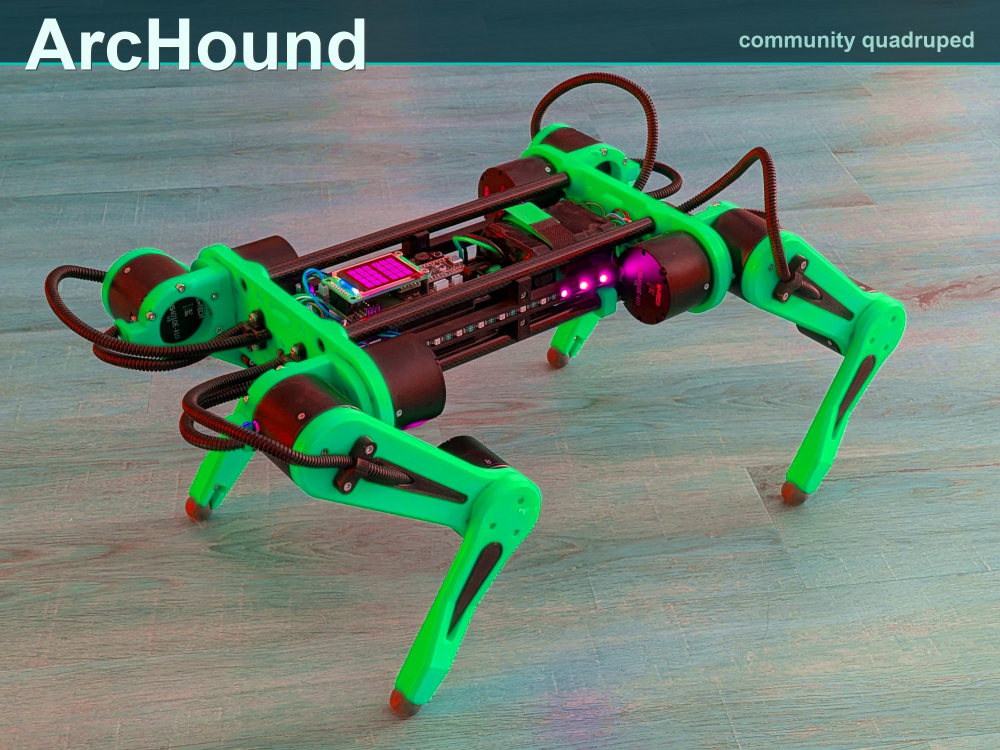
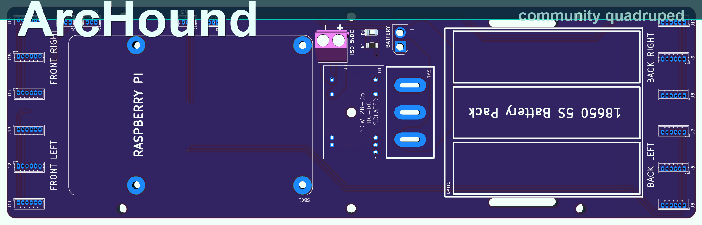
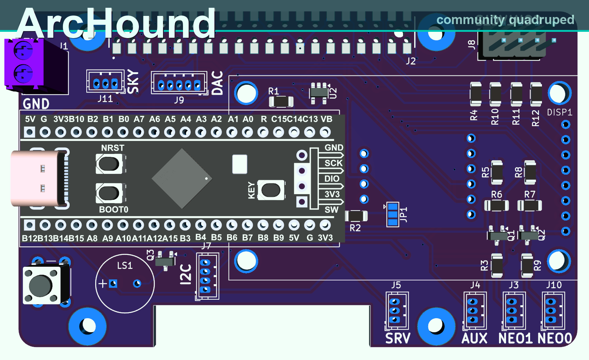
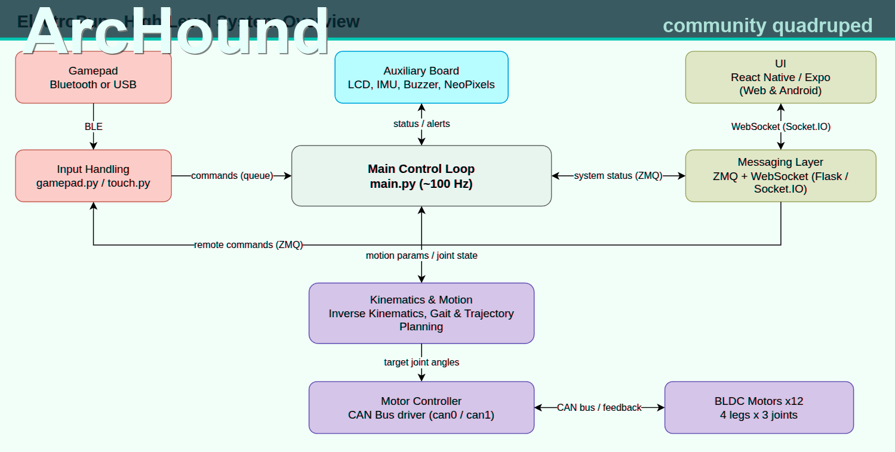
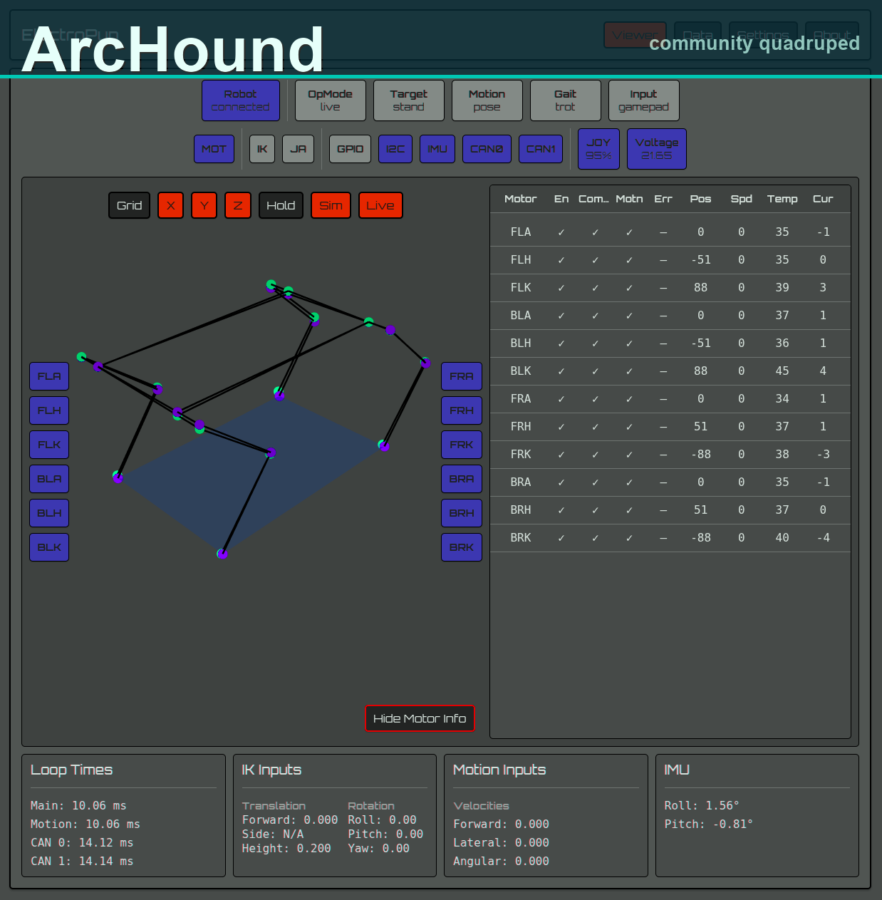

# ArcHound

<p align="center">
  
</p>

**ArcHound** is a DIY 3D-printed quadruped — Raspberry Pi 5, twelve BLDC actuators, custom KiCad boards, Python control.

> Community packaging name: **ArcHound**  
> Based on upstream [reubenstr/ElectroPup](https://github.com/reubenstr/ElectroPup)  
> Docs packaging: [`LICENSE`](LICENSE) (MIT for fork-authored text) · [`NOTICE.md`](NOTICE.md)

[Poses](https://youtu.be/AJn_wCcWlwo) · [Walk / turn / strafe](https://youtu.be/YjTVNw8BXlM)

---

## Specs

| | |
|--|--|
| **Name** | ArcHound |
| Compute | Raspberry Pi 5 |
| Actuators | 12× LingKong MG4010E-i10v3 (CAN) |
| Aux | Optional STM32 + LCD / NeoPixels / buzzer |
| IMU | BNO055 |
| Battery | 6S Li-Ion ~72 Wh |
| Mass | ~4.5 kg |

---

## Files

| Path | Contents |
|------|----------|
| [`pcbs/`](pcbs/) | KiCad schematics, PCBs, gerbers |
| [`cad/`](cad/) | STL + STEP |
| [`docs/HARDWARE_AND_SCHEMATICS.md`](docs/HARDWARE_AND_SCHEMATICS.md) | Full schematic / BOM / datasheet index |
| [`firmware/aux/`](firmware/aux/) | STM32 PlatformIO |
| [`src/`](src/) | Control + UI + MuJoCo |
| [`images/`](images/) | ArcHound-branded (recolored) media |

Upstream README copy: [`docs/README_UPSTREAM.md`](docs/README_UPSTREAM.md)

---

## Schematics

1. [`docs/HARDWARE_AND_SCHEMATICS.md`](docs/HARDWARE_AND_SCHEMATICS.md)  
2. [`pcbs/power_carrier/power_carrier.kicad_sch`](pcbs/power_carrier/power_carrier.kicad_sch)  
3. [`pcbs/auxiliary-board/auxiliary-board.kicad_sch`](pcbs/auxiliary-board/auxiliary-board.kicad_sch)  
4. [`docs/can/2-CH-CAN-HAT-Schematic.pdf`](docs/can/2-CH-CAN-HAT-Schematic.pdf)  
5. [`docs/bom.ods`](docs/bom.ods)

<p>
  
  
</p>

---

## Software



Setup: [`docs/setup.md`](docs/setup.md) · Sim: `./src/sim.sh` · Live: `./src/main.sh`



---

## Clone

```bash
git clone https://github.com/ajju2004srivatsan-cloud/ArcHound.git
cd ArcHound
```

---

## Credits & license

- Design/implementation: **[reubenstr](https://github.com/reubenstr)** (ElectroPup upstream)  
- ArcHound packaging docs: MIT — [`LICENSE`](LICENSE)  
- Upstream design rights: [`NOTICE.md`](NOTICE.md) (upstream has no published LICENSE)
